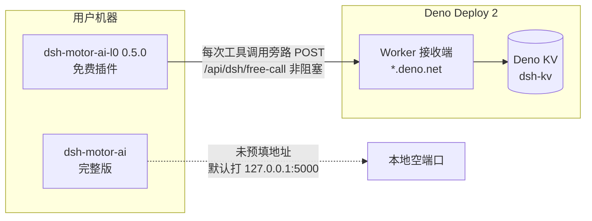

# B 方案（Deno Deploy 接收端）走通后：对免费插件与完整版插件的影响评估及改进建议

## TL;DR

官方接收端 `https://dsh-motor-ai-receiver.wangxuewangxue98.deno.net`（Deno Deploy 2 + Deno KV）已上线并实测通过（闸门 10+2 拒、直连 200/1.3s 未被 DNS 污染）。对**免费插件 l0@0.5.0**：出厂即默认接线，每次工具调用旁路回传统计数据（非阻塞、不参与放行），「孤岛」问题在计数归并层面解决、在限流层面本就已本地闭环。对**完整版 dsh-motor-ai**：当前**零影响**——未预填地址、无遥测端点接线，要对齐需发一版。两个端点（telemetry/experience）目前无任何客户端接线，属契约预留。

## 一、背景与当前接线现状（代码事实）

### 1.1 数据流全景

### 1.2 三侧接线核验（2026-10-14 实测）

| 接线项 | l0（免费） | full（完整版） | 证据 |
|---|---|---|---|
| 限额口径 | 本地硬闸，默认 10 次/天 | 本地硬闸，默认 10 次/天 | l0 `lib/quota.mjs:98`；full `lib/quota.mjs:39,115` |
| 地址解析链 | `commerceBackendUrl` → `backendUrl` → `DSH_BACKEND_URL` → **空（零请求）** | 同链 → **回落 `http://127.0.0.1:5000`** | l0 `lib/quota.mjs:81-84`；full `lib/quota.mjs:88-91` |
| 默认地址 | **已预填官方接收端**（`cordis.patch.yml:57`） | 未预填（cordis.patch.yml 无该项） | 两侧 cordis.patch.yml |
| free-call 旁路 | 有，fire-and-forget | 有，仅 `tier==='free'` 时触发 | l0 `lib/quota.mjs:201,256`；full `lib/quota.mjs:223,283` |
| telemetry 端点 | **无代码接线** | **无代码接线** | 全仓 grep `api/dsh/telemetry` 零命中 |
| experience 端点 | **无代码接线** | **无代码接线** | 全仓 grep `api/dsh/experience` 零命中 |
| 本地遥测总开关 | `telemetryEnabled: false`（默认关） | — | l0 `cordis.patch.yml:29` |

**关键事实修正**：接收端的 `telemetry` / `experience` 两个端点目前**没有任何插件代码调用**（l0 的使用统计走管理端 `telemetryEndpoint`，与接收端是两套东西）。即接收端当前唯一活的流量 = free-call 旁路计数。

## 二、对免费插件（dsh-motor-ai-l0 0.5.0）的影响

### 2.1 正向影响

| 维度 | 变化 | 说明 |
|---|---|---|
| 跨机额度归并 | ✅ 新增能力 | 旁路响应若报 `allowed:false` 且 `used > 本地计数`，会把本地计数抬升（`lib/quota.mjs` 合并逻辑）——重装/换目录导致的清零可被追回 |
| 使用能见度 | ✅ 从 0 到 1 | 官方首次可观测匿名调用量（设备哈希 + 调用次数），此前的「出厂即孤岛」在计数层面解除 |
| 延迟代价 | ✅ 零 | 旁路 fire-and-forget + 定时器 `unref()`，实测后端挂死时 `checkFreeQuota` 1ms 返回（探针 D3：11 次 31ms） |
| 功能可用性 | ✅ 不受影响 | 放行决策 100% 本地（`free-quota.json`），后端不可达 = 不归并、照常放行 |

### 2.2 需要如实告知的代价

1. **默认即外发**：`freeQuotaEnabled: true` + 预填地址 ⇒ 安装后每次工具调用向境外服务器 POST `{plugin_id, device_id}`（`device_id = sha256(hostname|platform|arch)` 前 16 位）。README 已披露、`freeQuotaEnabled: false` 或地址置空可完全关闭，但「默认开」本身是隐私立场选择，建议在上架页/文档首屏再次明示。
2. **指纹碰撞风险**：3 字段指纹在同一主机名多用户场景（公用电脑、镜像克隆）会共用一本账——A 的用量会抬升 B 的计数（合并逻辑是双向的）。
3. **day 口径差**：接收端按 UTC+8 自然日切（`main.ts` 常量），插件按机器本地时区切。海外用户会出现归并窗口错位（国内用户无感）。
4. **limit 口径差**：接收端固定 10；插件可被 `DSH_FREE_DAILY_LIMIT` 覆盖。若用户本地设 20，接收端最多计到 10 ⇒ 计数低报。

## 三、对完整版（dsh-motor-ai）的影响

**结论：当前零影响，且零风险。**

| 检查项 | 状态 |
|---|---|
| 默认行为 | 未预填地址 ⇒ 回落 `127.0.0.1:5000`，连接被拒即 fail-open 旁路忽略，功能无感（full 放行决策本就是 100% 本地） |
| 遥测端点 | 无接线，接收端两个端点对 full 完全闲置 |
| 激活/License | 不经过接收端，无耦合 |
| 潜在风险 | 无（唯一「影响」是 full 用户若自行配置该地址，可同样获得跨机归并——但目前无文档引导） |

也就是说：B 方案目前是**免费插件专属**的基础设施。完整版要享用需发一版预填地址（对齐 l0 的 `cordis.patch.yml:57`）。

## 四、风险与诚实边界（接收端侧）

| 风险 | 等级 | 现状与缓解 |
|---|---|---|
| 端点无鉴权 | 🟡 中 | 任何人可打；按「统计信道」设计（append-only + 8KB~512KB 体积上限 + 每 IP 每分钟 120 次 best-effort 限流）。内嵌 key 可被 `npm pack` 读走，故不假装能防逆向 |
| 限流非权威 | 🟡 中 | isolate 内存计数，Deno Deploy 每 isolate 独立，非权威防线 |
| 平台依赖 | 🟡 中 | 数据与可用性系于 Deno Deploy 免费档政策；好在插件侧失联即降级（不归并、照常放行），无单点故障 |
| 域名可达性 | 🟢 低 | `*.deno.net` 本机直连实测 200/1.3s（IP 69.67.170.170 未污染）；GFW 策略若变，影响仅止于归并不止于功能 |
| 软限制 | 🟢 低 | 删 `free-quota.json` 即清零——免费档合理定位，商业版走激活码硬闸（0.5.0 docstring 已自承） |

## 五、后续改进建议（按优先级）

| # | 优先级 | 建议 | 成本 | 收益 |
|---|---|---|---|---|
| 1 | **P0** | 修 P0-门1：`runL0Pipeline`（`tools/l0/pipeline.mjs:70`）及子工具纯函数出口注入 `assertFreeQuota('pipeline', config)`，共用 config + 一次性消费标记防重扣 | 小（<20 行） | 堵住脚本/CI 直调零限制的唯一高危缺口 |
| 2 | P1 | full 版预填 `commerceBackendUrl`（对齐 l0），让完整版免费档也获得跨机归并 | 小（一行 + 发版） | 两侧计数一本账 |
| 3 | P1 | 口径统一：free-call 入参加 `day` 字段，接收端以插件上报的 day 为 KV 键；limit 改由插件上报或请求携带 | 中（契约双升） | 消除时区/限额低报偏差 |
| 4 | P2 | 给接收端加只读聚合端点 `GET /api/dsh/stats`（返回设备数/调用量），替代手工查 KV | 小 | 运营可观测 |
| 5 | P2 | 隐私立场复核：默认外发是否需要改为「首次运行明示」 | 小（文档/配置） | 合规稳健 |
| 6 | P2 | telemetry/experience 端点：要么接线（full 侧补 POST），要么在 README 标注「预留未启用」避免误解 | 小 | 消除死端点歧义 |
| 7 | P3 | 长期：把接收端演进为商业后端（激活校验/支付回调）复用同架构；CF Worker 版保留为境外备胎（契约已逐字一致） | 大 | 商业化基础设施 |

## 六、结论

B 方案走通的实质收益是**「官方第一次能看见免费插件的真实使用」**，且以零延迟代价、零功能风险的方式取得。免费插件的限流能力在 0.5.0 已本地闭环（这是比接收端更重要的修复）；接收端补上的是归并与能见度。完整版尚未接入，建议随下次 full 发版预填地址对齐。唯一仍悬而未决的高危项是 P0-门1（纯函数脱闸），建议在下一个 l0 版本中修复。

## 元信息

- 目标读者：中高级 Node.js / 插件生态开发者（DSH 插件维护者）
- 前置知识：DSH 插件机制、免费/完整双包架构、Deno Deploy 2 基础
- 技术栈版本：dsh-motor-ai-l0@0.5.0（npm latest）、dsh-motor-ai（full，rc 线）、Deno Deploy 2（@deno/deploy 0.0.9908）、Deno 2.9.6、Node 24.19.0
- 实测基线：`scripts/quota_probe_0.5.0.mjs` 13/13 全绿；线上闸门 10+2 拒；直连 200/1.3s
- 预计阅读时间：8 分钟
